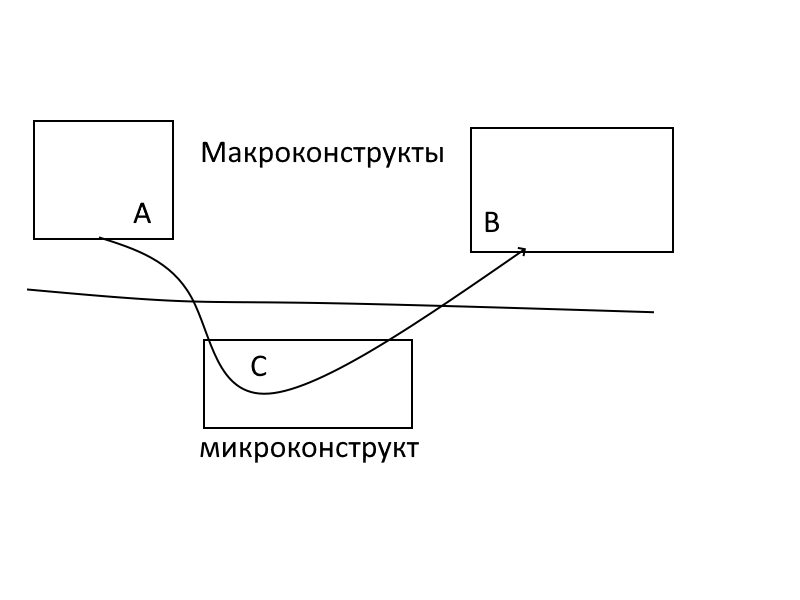
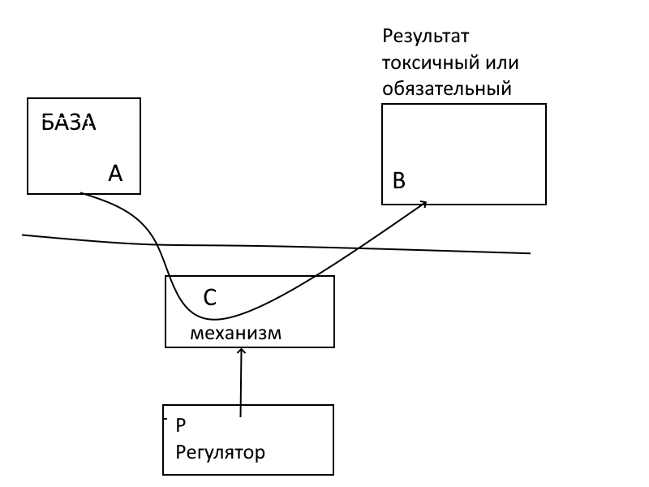

Оборачиваясь назад, я вижу свои плоды. Но их много, и они разные. Попробуем привести этот пейзаж в порядок.

Что считать единицей моего творчества в философии?
Модели? Ряды понятий? Системы правил?

На данный момент я отвечаю так. Единицей считаю проблему плюс решение. Но хочу обратить ваше внимание на то, как устроен этот идеальный конструкт (ПпР).

ПпР похож на «Подземный переход» и вот почему.
ПпР состоит из трех элементов.
Все эти элементы сконструированы умом, но по-разному. Есть два макро-элемента и один микроэлемент.

Смотри картинку.

В нашем случае А – представление о темпераментах, взятое из экскурса. В – свойства темперамента, наблюдаемые, меня интересующие. С одной стороны, А и В можно наблюдать, с другой – наблюдение – это выбор: из бесконечного множества параметров выделяются те, которые хочет автор. Если автор выбрал правильно, вся схема будет разобрана на длинный ряд приложений.

С – это механизм, который от нас скрыт, но если макрокомплексы надо выбрать из наблюдаемого, микрокомплекс надо буквально выдумать из ничего.

Каждый конкретный микрокомплекс дает одно определенное объяснение, как В зависит от А. Приняв определенный вариант С как рабочую гипотезу, можно получить множество гипотез, которые можно проверить наблюдением или экспериментом.

В случае «Темперамент-разогрев» А – это наше знание о темпераментах вообще из книг. В – наше представление о свойствах каждого темперамента. Например, В – те 4 шкалы, которыми я оцениваю темперамент.

После того как я выделил из множества наблюдений два конструкта А и В, я обещаю придумать такой конструкт С, чтобы связать свойства В со свойствами А причинно-следственной связью.

Такой выдумкой стал микроконструкт «четыре кривые разогрева и их свойства».

Знание того, что здесь микроконструкт, а что макроконструкты А и В, весьма полезно. Проделаем эту операцию на модели «плохая школа».

Задача «Плохая школа» формулируется так.

Советская (и российская) школа, в которой я работал, вредна для детей и для взрослых.

Каково же здесь решение? Разделим этот вопрос на два: 1) для детей и 2) для взрослых.

Рассмотрим первый вопрос.

А = развитие детей, как мы его наблюдаем, и работа школы. В = вред детям, как мы его наблюдаем.

Модель деятельности и ее сложность, измеряемая по шкале уровней, – это элемент С.

Замечание. В элементе С всегда есть скрытый параметр – описание сделает его явным. Варьируя этот параметр, мы начинаем понимать, что происходит. И вместо удивленного наблюдателя превращаемся в хозяина своей судьбы.

Так в ПпР появляется четвертый элемент – рекомендации – ПпРр.

И даже ПпРрР – проблема плюс решение равно рекомендации = П2Р3.

Это еще одно правило – как я рекомендую строить собственный дискурс философского типа.

## Дополнение

А = база: что существует и наблюдаемо
В = результат, токсичный или обязательный
С = механизм: как оно работает внутри
Р = регулятор: что и как изменить, чтобы стало лучше
