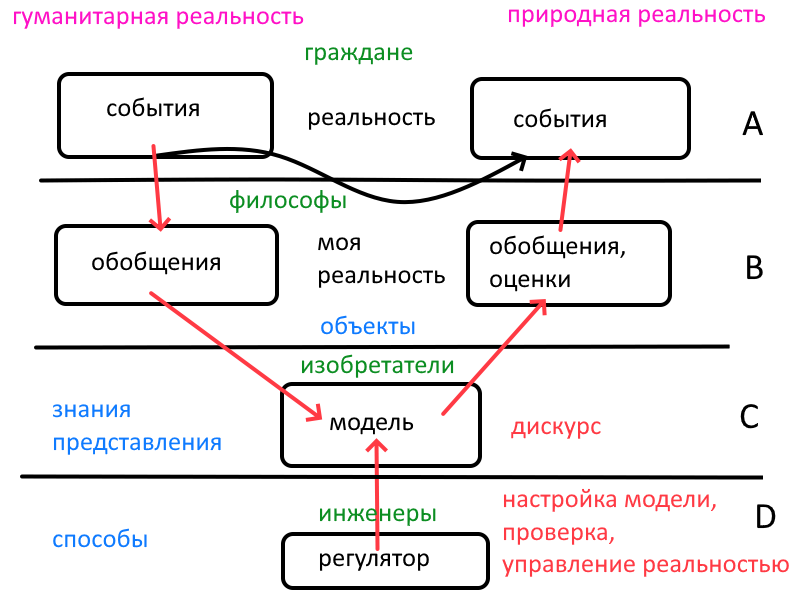

Мир состоит из событий. Каждое событие уникально и одноразово. Даже если два события кажутся повторениями друг друга, они неизбежно различаются в деталях.

Когда мы называем события повторениями, мы уже производим обобщение: выделяем общее и пренебрегаем различиями.

Это первое обобщение – обобщение событий.

Но существует и другое обобщение — обобщение результатов и оценок. Оно позволяет судить не только о том, что происходит, но и о том, хорошо или плохо происходящее, приемлем ли полученный результат.

Именно здесь возникает возможность целенаправленного управления реальностью.

## От обобщения к модели

Обобщения – только предпосылки теории, но еще не сама теория.

Теория начинается с мысленных экспериментов. Над чем? Над моделью.

Между обобщениями и моделью – скачок.

Пример Галилея.

Когда Галилей рассуждает о падающем камне и о двух его половинках, падающих рядом, это уже модель, но скачок тут не велик.

Но этого хватает, чтобы опровергнуть формулу Аристотеля «тяжелое падает быстрее».

Но когда он катает шары на наклонных скамьях, здесь уже скачок побольше. Теперь мы можем опровергнуть «по горизонтальной плоскости движение требует силы».

И наконец, колокольчики, измеряющие время – гениальный скачок и первая математическая формула ускоренного движения.

## Изобретатели и инженеры

Изобретатель строит модель, инженер использует её для управления.

При этом не требуется, чтобы модель воспроизводила реальность. Ибо как мы сопоставим ее с реальностью? Только через регулятор и его результат. Поэтому

Требуется результативность.

Если применение модели переводит ситуацию из зоны «ПЛОХО» в зону «ПРИЕМЛЕМО», значит модель хороша.

Хороший пример — уравнение Шрёдингера. Его значение определяется прежде всего огромным количеством успешных расчётов и предсказаний, которые оно позволяет делать.

## Проверка моделей

Прямой способ проверки — эксперимент. Но эксперимент возможен не всегда и не для всех условий.

Особенно это относится к гуманитарной реальности. Здесь обратная связь может существовать, но её цикл бывает чрезвычайно длинным. Результаты некоторых воздействий обнаруживаются лишь через многие годы.

Поэтому необходимы и косвенные способы проверки.

Первый — широкая применимость. Одна и та же модель успешно используется для решения множества разных задач.

Второй — перенос прогноза. Модель, построенная для одной области, позволяет предсказать закономерности в другой, прежде не исследованной с её помощью.

Третий — сэндвич. Это развитие второго способа.

С одной стороны, теория позволяет вывести определённые формулы. С другой стороны, исследование фактов в новой области приводит к таким же формулам.

Два пути встречаются.

Хорошо, когда теоретический результат был получен раньше наблюдений. Второй аргумент в пользу модели – простота вывода.

Важны также независимость путей и точность совпадения.

## Аксиомы и их результативность

В строгом дискурсе исходные положения принимаются однажды, после чего используются многократно.

Аксиомы не подбираются заново для каждой задачи.

Их ценность проявляется в том, что из одной системы исходных положений удаётся получать множество полезных результатов. Если однажды построенная система позволяет решать тысячи задач, не изменяя аксиоматики, это свидетельствует в её пользу.

## Как развиваются модели

Успешную модель не принято менять только потому, что появилась новая задача.

Иногда обнаруживается фактор, который раньше не учитывался. Тогда можно построить дополнительную модель, сохранив прежнюю.

Характерный пример — контекст, то есть общее содержание, которым располагают участники взаимодействия.

Во многих ситуациях наличие общего контекста кажется настолько очевидным, что его вообще не рассматривают как отдельный фактор.

Но в проблеме диалога двух незнакомцев контекст неожиданно становится существенным. Отсутствие общего контекста попросту не позволяет начать диалог, о развитии – речи не идет.

Так появляется дополнительная модель контекста.

Развитие теории, следовательно, не обязательно означает отказ от прежних моделей. Оно может означать расширение набора моделей.

## Согласование моделей

Разные модели описывают разные стороны одной реальности. Поэтому при их совместном применении приходится исследовать взаимное влияние описываемых факторов.

Рассмотрим пример из теории уровней и темпераментов.

В модели уровней нечётные уровни связаны с индивидуализмом. В модели темпераментов индивидуализм связан с быстрыми темпераментами.

Однако для согласования этих двух моделей необходимо дополнительное условие — характер воспитания.

Рассмотрим наивного воспитателя.

Наивный воспитатель оценивает выполнение задачи как успешное или неуспешное, не располагая дополнительными данными, например о том, как воспринимают успех воспитанника его товарищи.

Воспитатель может считать задачу успешно решённой, не замечая её социальных последствий.

Здесь встречаются три модели: уровней, темпераментов и воспитания. Для решения конкретной задачи требуется их согласование.

При этом каждая модель сохраняет своё самостоятельное значение.

## От отдельных моделей к системе

Таким образом, исследование и управление реальностью можно представить как последовательное движение:

События → Обобщения → Модели → Согласование моделей → Управление → Результаты → Оценки.

Полученные результаты возвращаются в исследование. Иногда быстро, иногда через длительное время.

Работающая модель сохраняется. Новый существенный фактор требует дополнительной модели. Взаимодействие факторов требует согласования моделей.

Так постепенно строится система знаний, ценность которой определяется количеством и разнообразием задач, которые она позволяет успешно решать.
