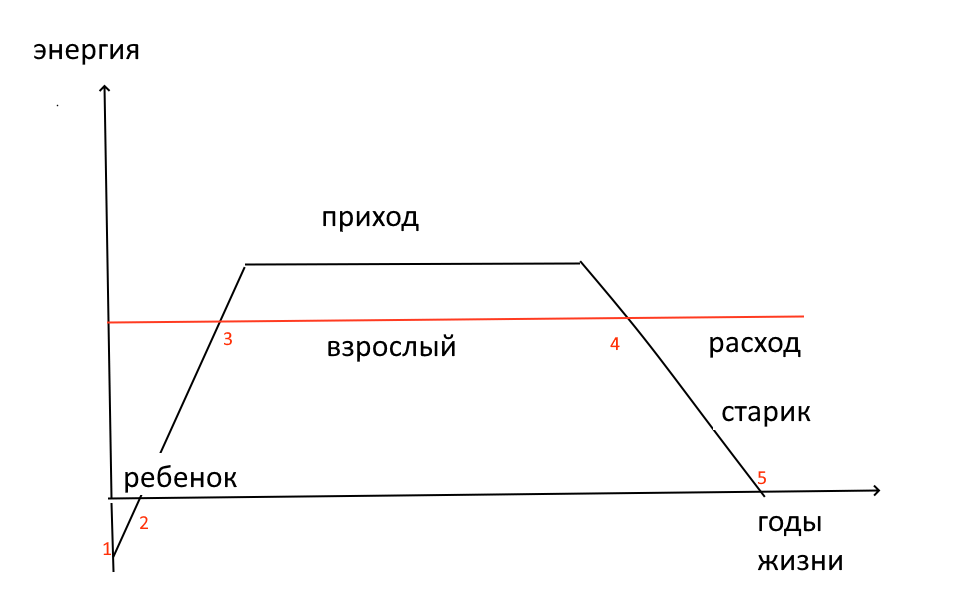

Это первая задача из списка ранних.

Я учился в советской школе. В школьной программе «русская литература» значительную часть занимал Александр Пушкин. И поделом. Создатель русского языка. Умнейший человек России (император Николай Первый своей жене).

Убит на дуэли, на которую сам напросился.

Лермонтов обвинил в его гибели «окружение царя», за что отправился на Кавказ в службу-ссылку – и там напросился на дуэльную пулю сам.

К этим двум вершинам русской литературы добавьте еще две:
Маяковский (застрелился) и Есенин (повесился).

И вот я, юный, талантливый, очень умный, пишущий стихи.

Если я пойду за ними, не понимая отчего они умерли, я тоже умру в 37 лет.

Я должен понять причину прежде, чем войду во взрослую жизнь.

Понять – значит составить модель, пригодную для мысленных экспериментов.

Попробуем составить такую модель.

Что такое 37 лет?

Это возраст, когда мужчина становится стариком.
Чем мужчина отличается от старика? Энергией.
Но ряд (мужчина, старик) не полон.

Добавим еще «ребенок».

Правильный ряд такой:

Ребенок – мужчина – старик.

Предположим, все трое живут рядом.
Чем они отличаются друг от друга и как между собой взаимодействуют?

Ни ребенок, ни старик, не могут сами решить все проблемы, которые у них объективно возникают. Они нуждаются в помощи.

Мужчина может оказать им такую помощь.

Итак, смотрим на картинку.

Точки

1 – зачатие, 2 – рождение, 3 – взрослость началась, 4 – старость началась, 5 – смерть.

Что происходит в обычной семейной жизни?

Будем считать, что для нормальной жизни человеку нужно решить определенный объем задач и потратить определенный объем энергии. Этот объем показан красной линией.

Черная линия (трапеция) показывает приход энергии.

Таким образом, на отрезке 3-4 у мужчины избыток энергии и он может ей делиться (с детьми и стариками).

Но что значит «делиться энергией»?

Перед человеком все время возникают задачи.
Например, чтобы идти гулять, нужно одеться. Ребенок (маленький) сам одеться не может. Кто-то должен поделиться с ним своей энергией – закончить то, что ребенок начал.
То есть задачи у человека возникают сами, это «постоянный расход, долг». А за завершение задачи надо платить. А ресурсов на оплату (у ребёнка и старика) недостаточно – он просит у взрослых.

Посмотрим на жизнь поэтов через эту модель.

1. Гений – имеет ту же кривую прихода, что обычный человек.
2. Кривая расхода не меньше, а больше, выше – гениальное творчество требует энергии
3. В точке, где приход идет на спад, поэт остается один и в дефиците. А чтобы остаться в живых, нужна энергия, а ее нет

**Практические выводы**: 1) следи за балансом и 2) будь среди друзей, выбирай таких друзей, которые готовы помочь, на друзей тратить время и силы -  правильно. Оно того стоит.

## Современный анализ.

Это не научное знание,

Это представление о мире. Вытекающие из него оценки и способы – работают.

Мне скоро 70, я живой, и я поэт.

Это – практическая польза.

Может показаться, что тема «энергообмен» из первой статьи не имеет продолжения в будущем. Но это не так. Смотри четвертую тетрадь.
