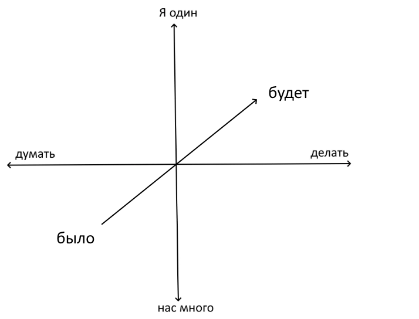

Рассмотрим все проблемы, которые могут возникнуть перед человечеством и перед отдельным человеком. Прежде всего отберем те проблемы, из которых человека можно вынести за скобки.
Остались те проблемы, из которых человека вынести за скобки нельзя.

Первая группа проблем ведет к естествознанию, включая математику. Там все идет успешно, методы, придуманные там, весьма мощные и результативные.

Вторую группу проблем взяли на себя гуманитарии, включая философов. Там все плохо. Именно там нужна наша помощь.

Эти проблемы — с человеком — образуют некоторое пространство, которое я считаю трехмерным.

Оси координат смотри на рисунке.
В дальнейшем я не буду рисовать ось времени, чтобы не загромождать картинку, но знайте, что она есть всегда.
