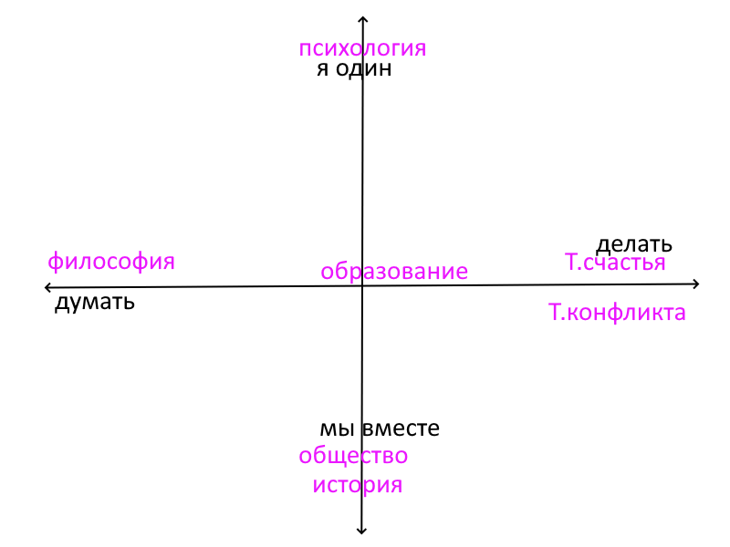

Даже имея оси координат, можно по-разному делить проблемы в этом пространстве. Первое деление — на области.

На самом деле перед нами пять областей (теорию счастья и теорию конфликта мы чуть позже объединим в теорию повседневности).
