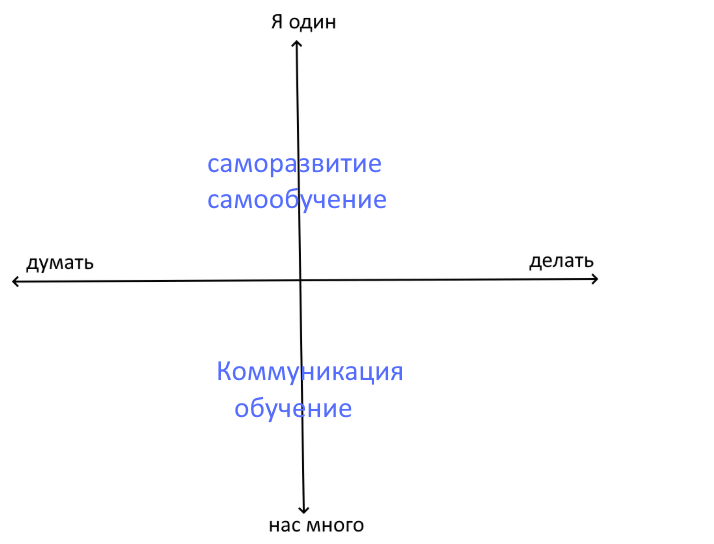

Потоки верхние подобны потокам нижним, второй стороной служит культура.
Одни оставляют свои сообщения-произведения в культуре, другие черпают их оттуда.
В коммуникации обе стороны — люди.

Каждое из трех делений имеет свое развертывание и свои результаты
(Моцарт). Отвечая на вопросы — каково место этих текстов в обществе и культуре (Бетховен) — я использую эти ряды как аргумент.
