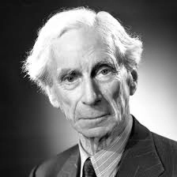
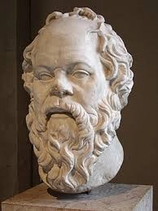
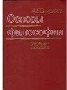

Ответы на этот вопрос могут быть двух видов, извне и изнутри.
Ответы извне возникают, когда мы помещаем философию в более широкую систему: сколько таких систем, столько и ответов, то есть бесконечно. Один из них мы привели выше.
А вот ответов изнутри — конечное число.

Я поискал по всей истории философии и нашел несводимые друг к другу шесть ответов на этот вопрос.

Определения философии изнутри
и почему их шесть

**Учебник философии** определяет философию как знание/поиск наиболее общих законов всего.
**Сократ**: философия это искусство задавать вопросы.
**Бертран Рассел**. Когда от проблемы отказались наука и искусство, ее отдают философам.
**Конфуций**. Я бы сказал правителю: начни с исправления имён.
**Витгенштейн ранний**: если вы набрели на проблему, которая не решается, виноват язык, на котором вы формулируете вашу проблему.
**Витгенштейн поздний**. Люди не понимают друг друга из-за сидящих в их головах разных контекстов. Философы, изучайте контексты.
**Камю**. Философия должна помочь человеку выжить.

Перед нами определения философии, данные внутри самой философии.
Нет ли среди них одинаковых? Есть. Конфуций совпал с ранним Витгенштейном. Оба утверждают, что философия должна починить язык.

Различны ли оставшиеся шесть определений?
Да.
Возможны ли определения кроме этих?
Нет.
Покажем это.

Рассмотрим абстрактную ситуацию — противостояние двух сторон. Пусть порядок сторон не важен. Стороны внутри ситуации могут быть одного типа.
И пусть стороны бывают трёх типов. На сколько типов распадается такая ситуация?
Правильный ответ **шесть**.
Не буду давать строгое доказательство, а просто приведу список вариантов.
АА, АБ, АВ, ББ, ВВ, БВ

Вообразим каждую из шести ситуаций и попробуем понять, какое именно определение философии подходит для каждой из этих шести ситуаций.

Ситуация **вещь против вещи**. Конечно, тут надо думать о мире, который
детерминирован, управляется законами и хорошо бы понять эти законы. Тут нет человека. Тут нет человеческих групп, никто не нарушает законов. Вещи законам подчиняются. Поэтому изучать законы имеет смысл.

**Вторая ситуация:** человек против вещей. Конечно, такому человеку надо задавать вопросы вещам, и вещи будут отвечать — так появится новое знание. Мы попали в определение Сократа.

**Третья ситуация**: человек против сообщества или общества. Общество этого человека давит, и ему надо выжить. Тут появляется определение Камю: человеку надо выжить.

Следующее **четвёртое определение:** группа против группы. Важнейшие группы — это наука, искусство и философия. И тут мы попадаем в определение, которое дал Бертран Рассел.

Остались ещё две ситуации.
**Ситуация пятая.** Человек против человека. Тут мы попадаем в определение позднего Витгенштейна. Главная проблема — коммуникация.

И наконец **ситуация шестая**. Сообщество против вещей. Чтобы такое сообщество работало, ему нужно выработать единый язык. Вот почему возникает проблема правильного языка, и исправить этот язык должна философия. Так мы попадаем в определение Конфуция и раннего Витгенштейна.

Фактически перед нами шесть разных философий. Они отличаются главной рамкой.

