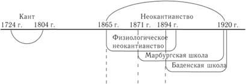
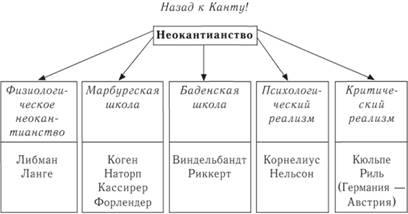

Из книги «Философия++» (2021–2023). Приложение к «Книге Открытий».

## Часть шестая. Прощание с Аристотелем

Есть одна тема, которая занимает меня давно (чуть не сказал «с рождения»). Тема эта (как мне кажется) сегодня не волнует никого, кроме меня. Видимо, дело в том, что тема активно обсуждалась полтора века назад, и сегодня считается, что тема закрыта. Думаю, пора тему открыть, проветрить. Что за тема? Когда обсуждалась, кем?

Я имею в виду тему о соотношении естествознания и гуманитарного знания. В свое время она активно обсуждалась Кантом и неокантианцами. Но Кант умер в 1804 году. А неокантианцев энциклопедии располагают между 1865-м и 1920-м годом. Это сто — сто пятьдесят лет назад.

Рисунок 1. Хронология неокантианства

Рисунок 2. Неокантианцы: школы, имена (1865–1920)

Кантианство в эти пятьдесят пять лет было мощным разветвленным течением. Энциклопедии называют минимум пять школ внутри течения. Ареал обитания — Европа, в основном Германия и Австрия. Многие юноши со всей Европы приезжали к ним учиться, в том числе из России.

Например, летом 1912 года в Марбургском университете у профессора философии Германа Когена стажировался будущий лауреат Нобелевской премии по литературе Борис Пастернак.

СССР печатал Маркса миллионными тиражами, но СССР обрушился, и репутация Маркса осталась лежать под его обломками. Рикошетом досталось Гегелю, сначала много плюсов, затем столько же минусов. Канта миновала чаша сия. Даже Карл Поппер (1902–1994) считал, что Маркс, Гегель и Платон морально устарели, но не Кант. Кант (по Попперу) свеж и молод.

Я думаю, уважение к Канту сегодня тормозит развитие «наук о духе», но это отрицательное влияние отнюдь не очевидно, это надо объяснять и показывать, чем мы и займемся прямо сейчас.
