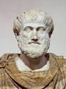
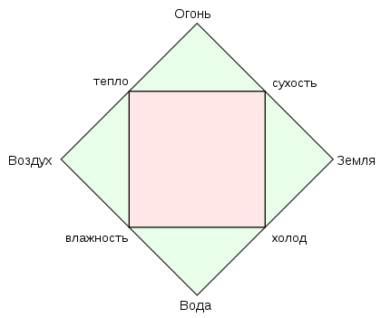
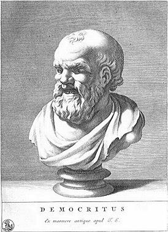
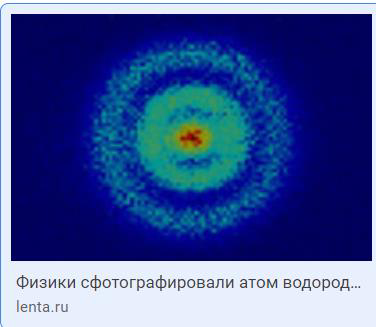
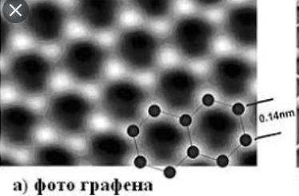
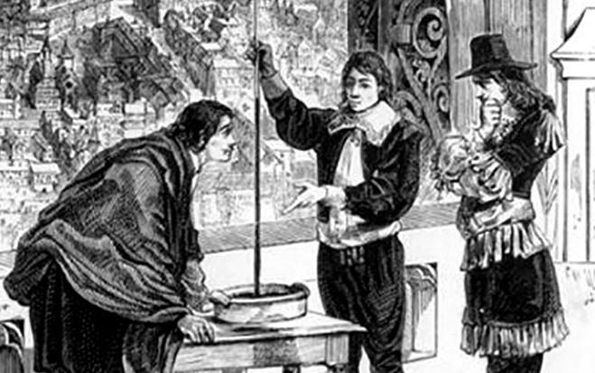

> Все гуманитарное знание выросло из Аристотеля,
> а все естествознание — из Платона.
>
> Сергей Егоров

> Ваше утверждение ложно, во-первых, исторически
> и, во-вторых, методологически.
>
> Яков Фельдман

> То, что мы называем сметаной, сметаной не является.
>
> Михаил Жванецкий

Друзья мои, все вы знаете, кто такой Аристотель. Напомню лишь, что жил он в четвертом веке до нашей эры и до самой смерти философа Платона считался его первым учеником. Но Платон умер, и Аристотель основал собственную школу. До нас дошли лекции Аристотеля, записанные его учениками. В этих лекциях Аристотель разбивает систему Платона в пух и прах, не оставляя камня на камне.

В Темные века и Платон, и Аристотель как бы исчезли.

Но уже в высокое европейское Средневековье — и вплоть до Галилея — эти три источника — Платон, Аристотель и Священное Писание — покрывали все, что нужно знать ученому европейцу. Правда, доходили из прошлого и иные мотивы. Коперник, например, восхищался пифагорейцами, а Галилей читал недавно найденный в архивах текст Архимеда.

Рисунок 1. Аристотель (384–322 до н. э.)

Но вряд ли, друзья мои, вы слышали, кто такой Сергей Нестерович Егоров, слова которого о Платоне и Аристотеле я вынес в эпиграф. А между тем он наш современник и автор книг, излагающих логику и методологию Аристотеля для нас с вами (и я полагаю, что он передает смысл аристотелевских конструкций аутентично).

Я имею в виду следующие четыре книги Егорова:

- «Аксиоматические основы теории права», 2001
- «Понятие» (СПб, 2006)
- «Суждение» (СПб, 2010)
- «Умозаключение» (СПб, 2014)

Вот две цитаты из этих книг, совершенно в духе Аристотеля.

> Мы в дальнейшем под «понятием» будем понимать любой мыслимый абстрактный объект, отграниченный от любого другого мыслимого абстрактного объекта по своим существенным признакам.
>
> Совокупность существенных признаков понятия составляет его содержание, которое отражается в его определении.
>
> «Аксиоматические основы теории права», 2001

> А34. Без семантической связи с познаваемой объективной реальностью не может быть логики.
>
> А58. Познаваемую объективную реальность составляют только объекты.
>
> А59. Каждый объект обладает набором признаков.
>
> О24. Признак — это свойство, присущее объекту, то, чем объекты могут походить друг на друга или отличаться друг от друга.
>
> А60. В качестве признака всегда выступает представление.
>
> А61. Представление — несовершенный (недостаточно качественный) признак.
>
> А62. Понятие — совершенный признак.
>
> «Суждение», 2010

Несколько неточностей, которые я тут заметил.

Первая неточность. Понятие — совершенный признак. Представление — несовершенный признак. То есть множество «признаки» распалось на два непересекающихся подмножества — представления и понятия. С другой стороны, всякий признак есть представление. То есть множество понятий пусто?

Думаю, автор не имел такого в виду, «оно само так вышло».

Вторая неточность. В первой цитате «понятие есть любой мыслимый абстрактный объект». Во второй цитате «познаваемую мыслимую реальность составляют только объекты». Это два разных типа объектов? Или один и тот же тип объектов? Судя по тому, что «без семантической связи с познаваемой объективной реальностью не может быть логики», один и тот же.

Но тогда это не что иное, как отождествление карты и территории, или — на другом языке — отождествление формальной системы и ее интерпретации. Это плохое отождествление.

Третья неточность. У Либмана читаем (смотри выше): «естествознание использует метод, обобщающий факты».

У Егорова читаем (смотри выше): «признак — это свойство, присущее объекту», «объект отличим от другого по своим существенным признакам», «понятие — существенный признак», «понятие — абстрактный объект как совокупность своих существенных признаков».

То есть — перевожу на понятный язык — правильный ученый наблюдает объекты (которые ему даны, например, прохожих из окна). У объектов видны объективные признаки (например, усы и бороды). Задача ученого — выделить из всех признаков существенные (то есть он может сказать, что усы — это не существенно, а бороды — существенно, и что мужчина — это человек с бородой — это было определение). Конец работы ученого.

В этом Либман и Егоров согласны. Отличие в том, что Либман описывает так только естествознание, а Егоров — любое познание.

По моему глубокому убеждению, оба не правы. Естествознание так не работает. А то, что так работает, не естествознание, по крайней мере сегодня естествознанием не считается.

Замечание. СЯУ (сегодня я узнал), что Эдмунд Гуссерль (1859–1938) построил свою оригинальную философию (которую называют феноменология) на одной оригинальной идее: надо отделять существенные признаки (феноменов сознания) от несущественных. Как свежо.

Четвертая неточность. «Все гуманитарное знание выросло из Аристотеля, а все естествознание — из Платона». (Эпиграф).

Приведу факты, которые прошли мимо господина Егорова. Примерно до 1630 года именно Аристотель считался отцом естествознания. Вот, например, как выглядела физика по Аристотелю (материал из Википедии):

Рисунок 2. Физика Аристотеля

Есть четыре первичные субстанции — воздух, огонь, земля, вода.

Это абстрактно мыслимые, но при этом объективно данные объекты.

И есть четыре фундаментальных признака — холод, тепло, сухость, влажность.

Четыре признака и четыре субстанции связаны меж собою простым, понятным и — главное — наблюдаемым способом.

То есть все как хотел господин Егоров: перед нами объективно присущие, объективно наблюдаемые существенные признаки объектов. Группируясь, существенные признаки образуют эти понятия (они же мыслимые абстрактные объекты), а именно:

- Огонь = тепло + сухость
- Воздух = тепло + влажность
- Вода = холод + влажность
- Земля = холод + сухость

Красиво, не правда ли? И главное — все понятно, гуманитарии в восторге.

В терминах «этажей» можно сказать, что метод Аристотеля допускает переход с этажа 1 (факты, обобщения) на этаж 2 (знания, измерения, вычисления, модели), но запрещает попадание на этаж 2 каким бы то ни было иным способом.

Иными словами, метод Аристотеля требует, чтобы в ранг понятий возводились прямо наблюдаемые факты. А ненаблюдаемые не возводились.

Самое время вспомнить имя другого грека, который сегодня считается истинным (биологическим) отцом современной физики.

Звали его Демокрит, и родился он на 80 лет раньше Аристотеля.

Рисунок 3. Демокрит (460–370 до н. э.)

Учитель Аристотеля Платон знал о Демокрите достаточно, чтобы его не любить. А не любил он его настолько сильно, что ученики Платона потратили много денег, скупая копии трудов Демокрита и методично их уничтожая. (Первоисточник — Диоген Лаэртский.)

Чем же прославился Демокрит? Демокрит считал, что существуют только атомы, очень мелкие, невидимые глазу, которые непрерывно движутся в пустоте. И больше ничего нет.

Аристотель старался не употреблять имени Демокрита, но прямо заявлял, что пустоты не существует, а уж тем более не существует атомов, невидимых глазу.

И то и другое давно уже опровергнуто.

Рисунок 4. Атом водорода. Сообщение 2013 года

Рисунок 5. На фотографии — атомы графена. Нобелевская премия 2010 года

Рисунок 6. Блез Паскаль (тут ему 23 года) демонстрирует друзьям создание пустоты по методу Торричелли

Демокрит не выводил атомы из наблюдаемых явлений — он их придумал.

Замечание. Эпикур (341–271 до н. э.) знал концепцию Демокрита и сам внес в нее важное дополнение. В отличие от атомов Демокрита — двигающихся по прямой линии — атомы Эпикура могли самопроизвольно от прямой линии уклоняться. Это снимало с природы заклятье предопределенности (физического детерминизма) и впускало в нее случайность и свободу воли. В таком мире уже не нужно было спасать человека-субъекта от физики Ньютона. Знал ли Кант концепцию Эпикура? Думаю, что нет.

Правоту Эпикура подтвердили в ХХ веке создатели квантовой механики.

Лукреций Кар (99–55 до н. э.) в поэме «О природе вещей», пересказывая учение Эпикура, вспоминает о хаотическом движении пылинок в солнечном луче. Вот как — говорит Лукреций Кар — выглядит движение атомов.

Во-первых, движение пылинок в солнечном луче есть не что иное, как броуновское движение. Пылинки не атомы, но их движение прямо связано с движением атомов (молекул).

Во-вторых, не исключено, что Демокрит придумал атомы, наблюдая такие пляшущие пылинки.

Фактически он «построил модель по аналогии». Современная физика полна моделями по аналогии: электрический ток подобен движению воды в реке, распространение света подобно волнам на поверхности озера и пр. Короче: Демокрит «угадал, как правильно строить науку», а Аристотель — не угадал.
