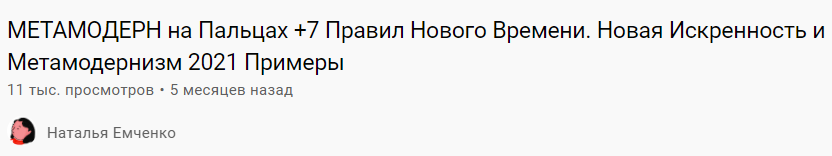
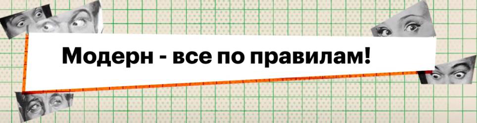
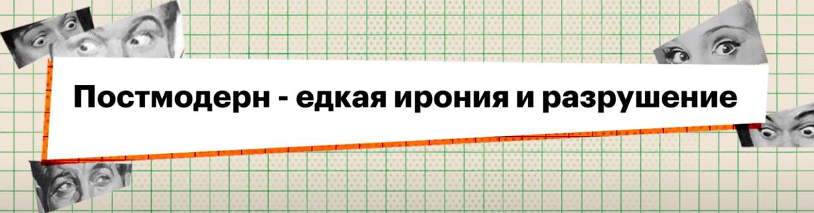
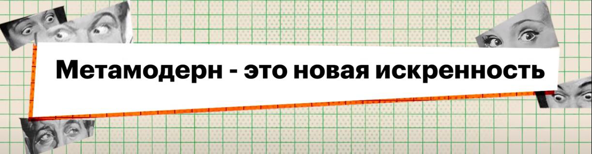

А вот еще лекция про метамодерн, уже не о музыке, не об искусстве даже, а о всяком мышлении.

https://youtu.be/OXetQQJ7p1g

А вот содержание этой лекции:

- Сначала грубое различение трех стилей,
- затем семь правил метамодерна.

Давайте, не откладывая, переведем эти три фразы на язык ТУАИ.

- Правила — уровень 4.
- Разрушение — нечетные уровни.
- Едкая ирония — это 57: 5 — импровизация; 7 — оригинальные идеи.
- Новая искренность — это что?

Видимо, создатель термина предполагал, что

- была старая (наивная) искренность, связанная с уровнями 1 и 3: «мне больно» — 1; «я хочу, и я возьму» — 3;
- потом была «опытная неискренность», связанная с уровнями 2 и 4: простыми запретами (ведите себя тихо!) — 2; ролевой системой (ведите себя прилично!) — 4;
- потом появился умудренный цинизм 57: 5 — импровизация; 7 — оригинальные идеи;
- наконец появилась «новая искренность» 568: 5 — смелость сказать; 6 — связное высказывание; 8 — сказать об общезначимом в форме, полезной всем.

## Итого

- Умудренный цинизм — это постмодерн (57).
- Новая искренность — метамодерн (568).
- Модерн включает 4, но — по другим признакам — это 467 (покажем ниже).

Вот таблица об этом (историческая последовательность стилей):

- Ренессанс
- Барокко
- Классицизм
- Просвещение
- Романтизм
- Модернизм — 467
- Постмодернизм — 57
- Метамодернизм — 568
