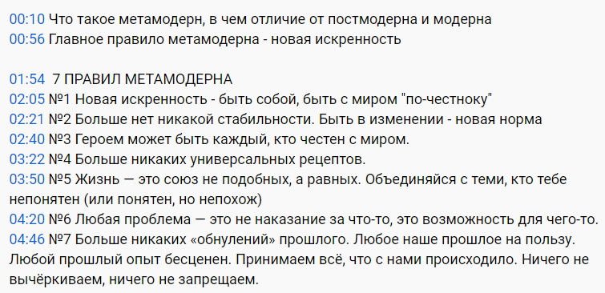

Это текст под видео с тайм-кодами.

И в переводе на язык ТУАИ:

| | Правила | Уровни, которых нет | Уровни, которые есть |
|---|---|---|---|
| 1 | Новая искренность — быть собой, быть с миром «по-честному» | | 568 |
| 2 | Больше нет никакой стабильности. Быть в изменении — новая норма | 24 | 567 |
| 3 | Героем может быть каждый, кто честен с миром | 34 | 568 |
| 4 | Больше никаких универсальных рецептов | 4 | 5 |
| 5 | Жизнь — это союз не подобных, а равных. Объединяйся с теми, кто тебе непонятен (или понятен, но непохож) | 24 | 58 |
| 6 | Любая проблема — это не наказание за что-то, это возможность для чего-то | 1234 | 5678 |
| 7 | Больше никаких «обнулений» прошлого. Любое наше прошлое на пользу. Любой прошлый опыт бесценен. Принимаем всё, что с нами происходило. Ничего не вычёркиваем, ничего не запрещаем | 46, 57 | 568 |

Замечание 1. В пункте 5 неточность. Формально союз крестьянина с дворянином (ролевая система, 4) тоже попадает в категорию «союз непохожих», но ясно, что автор правил не это имел в виду.

Замечание 2. В пункте 7 подразумевается, что есть несколько версий прошлого:

- В основном честная, но сглаженная под концепцию (46, модерн)
- В основном лживая, построенная так, чтобы сбить с толку (57, постмодерн)
- Абсолютно честная, включающая личный опыт очевидцев (568, метамодерн)

Замечание 3. Проблема как наказание — это, конечно, 1234. Человек живет в системе правил и мифов. Кто нарушает правила, тот будет наказан свыше. Проблема как вызов — это уровень 5 и все, что выше.

Замечание 4. В пункте 2 неточность. Относительная стабильность была в модерне (46). В постмодерне стабильности уже не было.
