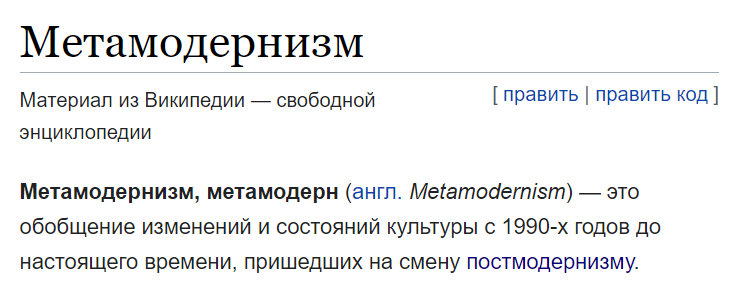
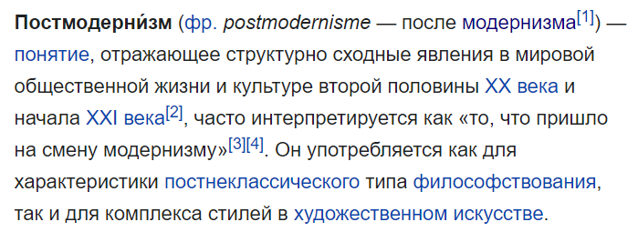
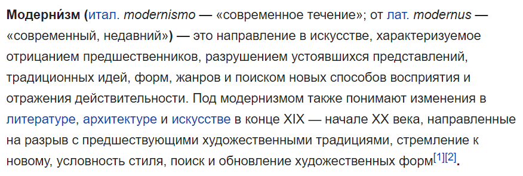
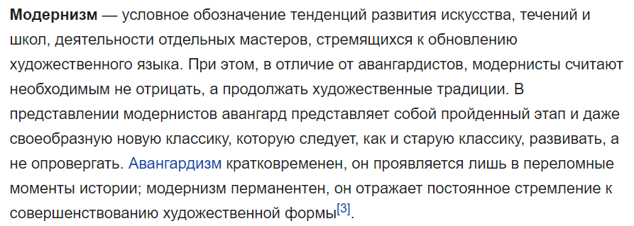

Открываю три статьи:

[Модернизм](https://ru.wikipedia.org/wiki/Модернизм) (М)

[Постмодернизм](https://ru.wikipedia.org/wiki/Постмодернизм) (ПМ)

[Метамодернизм](https://ru.wikipedia.org/wiki/Метамодернизм) (ММ)

И тут же, без паузы.

Замечание 1. Появился новый термин авангардизм. По сравнению с модернизмом в нем больше импульсивности и меньше продуманности. Поэтому модернизм это 467, а авангардизм это 457.

- Ренессанс
- Барокко
- Классицизм
- Просвещение
- Романтизм
- Авангардизм — 457
- Модернизм — 467
- Постмодернизм — 57
- Метамодернизм — 568

Замечание 2. Модернизм перманентен? То есть вечен? То есть имеет место быть для любого века? Really? Есть другой перевод слова перманентен — непрерывный, избегающий разрыва. Модернисты не подчеркивают своего разрыва с прошлым — но такой разрыв в модернизме несомненно присутствует, так что опять мимо. Постоянное стремление к совершенствованию формы есть и у Моцарта. Но Моцарт — не модернизм, Моцарт — классицизм.

Замечание 3. Сравнивая три статьи, выделим временные границы:

| Течение | Время господства |
|---|---|
| Модернизм | Со второй половины XIX — начале XX века |
| Постмодернизм | Со второй половины XX века до начала XXI века |
| Метамодернизм | С 1990-х годов до настоящего времени |

Замечание 4. Время господства — это «средняя температура по больнице». Нам надо научиться относить конкретное явление к определенному стилю (М, ПМ, ММ) по его содержательным свойствам, а не по его временной привязке.
