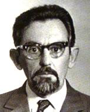
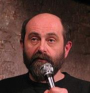
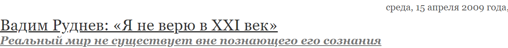

Давайте рассмотрим двух конкретных персонажей недавней русской истории, один из которых типичный представитель модернизма, а второй — типичный представитель постмодернизма. Я имею в виду Петра Александровича Руднева (отец) и Вадима Петровича Руднева (сын).

Петр Руднев (1925–1996) и Вадим Руднев (род. 1958)

Петр Руднев — серьезный ученый, причем научная школа, в русле которой он работает — структурное стиховедение — вполне оригинальна. То есть это самый настоящий модернизм — новое, оригинальное и при том хорошо организованное творчество.

Вадим Руднев напротив, отрицает не только объективную истину, но и саму объективную реальность. Это чистый постмодернизм. Вот два интервью с Вадимом Рудневым:

1. [Вадим Руднев: «Я не верю в XXI век»](http://www.chaskor.ru/article/vadim_rudnev_ya_ne_veryu_v_hhi_vek_5408)
2. [Интервью «Независимой газете»](https://www.ng.ru/person/2010-06-24/2_rudnev.html)

> — Я слышал, что вы изменили свое отношение к французской философии, которой прежде пренебрегали, так ли это?
>
> — В Тарту мы жили в такой изолированной среде (да и в Риге тоже), что фамилии Деррида и Делез я услышал только в 90-е годы, то есть на 20 лет позже, чем следовало.
>
> — Три года назад вы говорили, что французская философия вам ничего не дает…
>
> — А теперь полюбил и Делеза, и Гваттари. И Мишеля Фуко.
>
> — Но, например, Деррида читать невозможно…
>
> — И Делеза местами невозможно читать.

Делез, Деррида, Гваттари, Фуко — те самые «типичные представители», по которым читатель (по крайней мере читатель европейски образованный) узнает постмодернизм.

## Итого

Модернизм — создание новых творческих направлений со своим «духом и буквой».

Постмодернизм — паразитирование на том, что создал модернизм, извлечение творческой энергии через разрушение продуктов, накопленных модернистами.

Похоже на накопление солнечной энергии растениями — в первом случае — и обогревание дома дровами — во втором.
